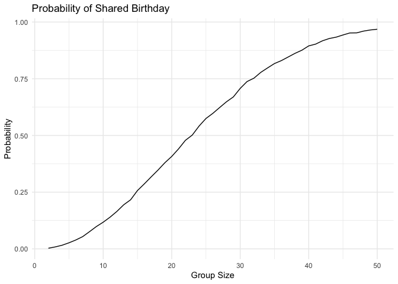

p8105_hw5_tw3131
================
Tianqing Wang
2026-11-18

``` r
library(tidyverse)
set.seed(1)
```

# Problem 1

``` r
birthday_match=function(n) {
  birthdays=sample(1:365, size=n, replace=TRUE)
  any(duplicated(birthdays))
}

birthday_match(23)
```

    ## [1] TRUE

``` r
birthday_results=
  expand_grid(
    group_size=2:50,
    iter=1:10000
  ) |>
  mutate(
    match=map_lgl(group_size,birthday_match)
  ) |>
  group_by(group_size) |>
  summarize(
    probability=mean(match)
  )
birthday_results
```

    ## # A tibble: 49 × 2
    ##    group_size probability
    ##         <int>       <dbl>
    ##  1          2      0.0028
    ##  2          3      0.0085
    ##  3          4      0.0159
    ##  4          5      0.0266
    ##  5          6      0.039 
    ##  6          7      0.0538
    ##  7          8      0.0757
    ##  8          9      0.0983
    ##  9         10      0.118 
    ## 10         11      0.140 
    ## # ℹ 39 more rows

``` r
birthday_results |>
  ggplot(aes(x=group_size, y=probability))+
  geom_line()+
  labs(
    title="Probability of Shared Birthday",
    x="Group Size",
    y="Probability"
  ) +
  theme_minimal()
```

<!-- -->

The probability of sharing a birthday increases with group size. With
approximately 23 people, the probability exceeds 50%, and it approaches
97% when the group size reaches 50.
