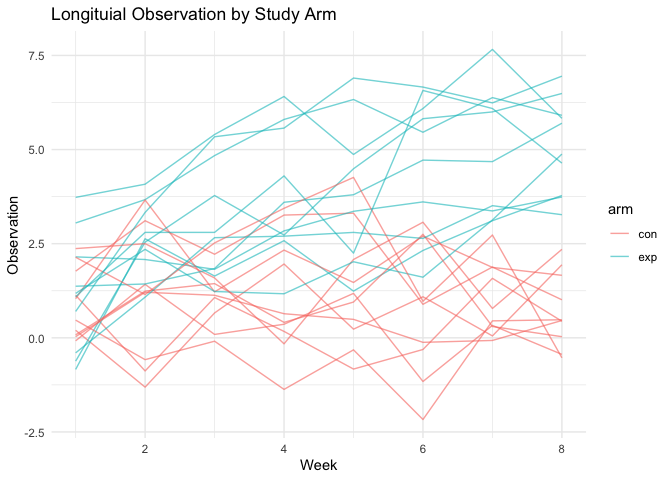
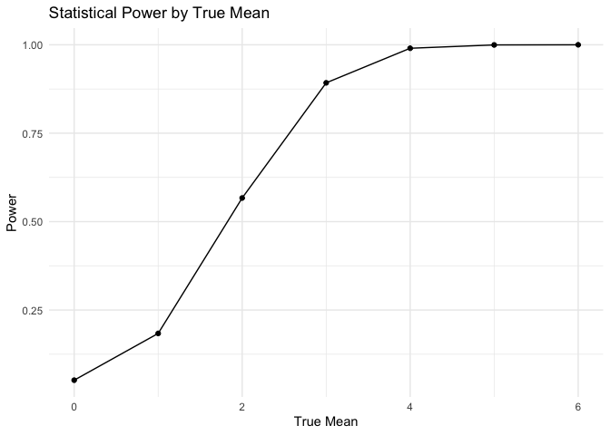
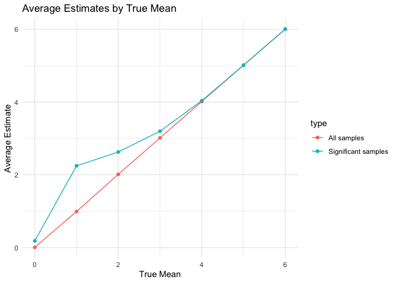

p8105_hw5_tw3131
================
Tianqing Wang
2026-11-18

``` r
library(tidyverse)
set.seed(1)
```

# Problem 1

``` r
birthday_match=function(n) {
  birthdays=sample(1:365, size=n, replace=TRUE)
  any(duplicated(birthdays))
}

birthday_match(23)
```

    ## [1] TRUE

``` r
birthday_results=
  expand_grid(
    group_size=2:50,
    iter=1:10000
  ) |>
  mutate(
    match=map_lgl(group_size,birthday_match)
  ) |>
  group_by(group_size) |>
  summarize(
    probability=mean(match)
  )
birthday_results
```

    ## # A tibble: 49 × 2
    ##    group_size probability
    ##         <int>       <dbl>
    ##  1          2      0.0028
    ##  2          3      0.0085
    ##  3          4      0.0159
    ##  4          5      0.0266
    ##  5          6      0.039 
    ##  6          7      0.0538
    ##  7          8      0.0757
    ##  8          9      0.0983
    ##  9         10      0.118 
    ## 10         11      0.140 
    ## # ℹ 39 more rows

``` r
birthday_results |>
  ggplot(aes(x=group_size, y=probability))+
  geom_line()+
  labs(
    title="Probability of Shared Birthdays",
    x="Group Size",
    y="Probability"
  ) +
  theme_minimal()
```

<!-- -->

The probability of sharing a birthday increases with group size. With
approximately 23 people, the probability exceeds 50%, and it approaches
97% when the group size reaches 50.

# Problem 2

``` r
file_list=list.files(
   path="data",
   pattern="\\.csv$",
   full.names= TRUE
 )

file_list
```

    ##  [1] "data/con_01.csv" "data/con_02.csv" "data/con_03.csv" "data/con_04.csv"
    ##  [5] "data/con_05.csv" "data/con_06.csv" "data/con_07.csv" "data/con_08.csv"
    ##  [9] "data/con_09.csv" "data/con_10.csv" "data/exp_01.csv" "data/exp_02.csv"
    ## [13] "data/exp_03.csv" "data/exp_04.csv" "data/exp_05.csv" "data/exp_06.csv"
    ## [17] "data/exp_07.csv" "data/exp_08.csv" "data/exp_09.csv" "data/exp_10.csv"

``` r
length(file_list)
```

    ## [1] 20

``` r
data_list=map(file_list,read_csv,show_col_types = FALSE)
length(data_list)
```

    ## [1] 20

``` r
data_list[[1]]
```

    ## # A tibble: 1 × 8
    ##   week_1 week_2 week_3 week_4 week_5 week_6 week_7 week_8
    ##    <dbl>  <dbl>  <dbl>  <dbl>  <dbl>  <dbl>  <dbl>  <dbl>
    ## 1    0.2  -1.31   0.66   1.96   0.23   1.09   0.05   1.94

``` r
longitudinal_df=tibble(
  filename=basename(file_list),
  data=data_list
)
longitudinal_df
```

    ## # A tibble: 20 × 2
    ##    filename   data              
    ##    <chr>      <list>            
    ##  1 con_01.csv <spc_tbl_ [1 × 8]>
    ##  2 con_02.csv <spc_tbl_ [1 × 8]>
    ##  3 con_03.csv <spc_tbl_ [1 × 8]>
    ##  4 con_04.csv <spc_tbl_ [1 × 8]>
    ##  5 con_05.csv <spc_tbl_ [1 × 8]>
    ##  6 con_06.csv <spc_tbl_ [1 × 8]>
    ##  7 con_07.csv <spc_tbl_ [1 × 8]>
    ##  8 con_08.csv <spc_tbl_ [1 × 8]>
    ##  9 con_09.csv <spc_tbl_ [1 × 8]>
    ## 10 con_10.csv <spc_tbl_ [1 × 8]>
    ## 11 exp_01.csv <spc_tbl_ [1 × 8]>
    ## 12 exp_02.csv <spc_tbl_ [1 × 8]>
    ## 13 exp_03.csv <spc_tbl_ [1 × 8]>
    ## 14 exp_04.csv <spc_tbl_ [1 × 8]>
    ## 15 exp_05.csv <spc_tbl_ [1 × 8]>
    ## 16 exp_06.csv <spc_tbl_ [1 × 8]>
    ## 17 exp_07.csv <spc_tbl_ [1 × 8]>
    ## 18 exp_08.csv <spc_tbl_ [1 × 8]>
    ## 19 exp_09.csv <spc_tbl_ [1 × 8]>
    ## 20 exp_10.csv <spc_tbl_ [1 × 8]>

``` r
longitudinal_df=longitudinal_df |>
  unnest(cols=data)
longitudinal_df
```

    ## # A tibble: 20 × 9
    ##    filename   week_1 week_2 week_3 week_4 week_5 week_6 week_7 week_8
    ##    <chr>       <dbl>  <dbl>  <dbl>  <dbl>  <dbl>  <dbl>  <dbl>  <dbl>
    ##  1 con_01.csv   0.2   -1.31   0.66   1.96   0.23   1.09   0.05   1.94
    ##  2 con_02.csv   1.13  -0.88   1.07   0.17  -0.83  -0.31   1.58   0.44
    ##  3 con_03.csv   1.77   3.11   2.22   3.26   3.31   0.89   1.88   1.01
    ##  4 con_04.csv   1.04   3.66   1.22   2.33   1.47   2.7    1.87   1.66
    ##  5 con_05.csv   0.47  -0.58  -0.09  -1.37  -0.32  -2.17   0.45   0.48
    ##  6 con_06.csv   2.37   2.5    1.59  -0.16   2.08   3.07   0.78   2.35
    ##  7 con_07.csv   0.03   1.21   1.13   0.64   0.49  -0.12  -0.07   0.46
    ##  8 con_08.csv  -0.08   1.42   0.09   0.36   1.18  -1.16   0.33  -0.44
    ##  9 con_09.csv   0.08   1.24   1.44   0.41   0.95   2.75   0.3    0.03
    ## 10 con_10.csv   2.14   1.15   2.52   3.44   4.26   0.97   2.73  -0.53
    ## 11 exp_01.csv   3.05   3.67   4.84   5.8    6.33   5.46   6.38   5.91
    ## 12 exp_02.csv  -0.84   2.63   1.64   2.58   1.24   2.32   3.11   3.78
    ## 13 exp_03.csv   2.15   2.08   1.82   2.84   3.36   3.61   3.37   3.74
    ## 14 exp_04.csv  -0.62   2.54   3.78   2.73   4.49   5.82   6      6.49
    ## 15 exp_05.csv   0.7    3.33   5.34   5.57   6.9    6.66   6.24   6.95
    ## 16 exp_06.csv   3.73   4.08   5.4    6.41   4.87   6.09   7.66   5.83
    ## 17 exp_07.csv   1.18   2.35   1.23   1.17   2.02   1.61   3.13   4.88
    ## 18 exp_08.csv   1.37   1.43   1.84   3.6    3.8    4.72   4.68   5.7 
    ## 19 exp_09.csv  -0.4    1.08   2.66   2.7    2.8    2.64   3.51   3.27
    ## 20 exp_10.csv   1.09   2.8    2.8    4.3    2.25   6.57   6.09   4.64

``` r
longitudinal_df=longitudinal_df |>
  mutate(
    filename=str_remove(filename,"\\.csv$")) |>
      separate(
        filename,
        into=c("arm","subject_id"),
        sep="_"
      )
longitudinal_df
```

    ## # A tibble: 20 × 10
    ##    arm   subject_id week_1 week_2 week_3 week_4 week_5 week_6 week_7 week_8
    ##    <chr> <chr>       <dbl>  <dbl>  <dbl>  <dbl>  <dbl>  <dbl>  <dbl>  <dbl>
    ##  1 con   01           0.2   -1.31   0.66   1.96   0.23   1.09   0.05   1.94
    ##  2 con   02           1.13  -0.88   1.07   0.17  -0.83  -0.31   1.58   0.44
    ##  3 con   03           1.77   3.11   2.22   3.26   3.31   0.89   1.88   1.01
    ##  4 con   04           1.04   3.66   1.22   2.33   1.47   2.7    1.87   1.66
    ##  5 con   05           0.47  -0.58  -0.09  -1.37  -0.32  -2.17   0.45   0.48
    ##  6 con   06           2.37   2.5    1.59  -0.16   2.08   3.07   0.78   2.35
    ##  7 con   07           0.03   1.21   1.13   0.64   0.49  -0.12  -0.07   0.46
    ##  8 con   08          -0.08   1.42   0.09   0.36   1.18  -1.16   0.33  -0.44
    ##  9 con   09           0.08   1.24   1.44   0.41   0.95   2.75   0.3    0.03
    ## 10 con   10           2.14   1.15   2.52   3.44   4.26   0.97   2.73  -0.53
    ## 11 exp   01           3.05   3.67   4.84   5.8    6.33   5.46   6.38   5.91
    ## 12 exp   02          -0.84   2.63   1.64   2.58   1.24   2.32   3.11   3.78
    ## 13 exp   03           2.15   2.08   1.82   2.84   3.36   3.61   3.37   3.74
    ## 14 exp   04          -0.62   2.54   3.78   2.73   4.49   5.82   6      6.49
    ## 15 exp   05           0.7    3.33   5.34   5.57   6.9    6.66   6.24   6.95
    ## 16 exp   06           3.73   4.08   5.4    6.41   4.87   6.09   7.66   5.83
    ## 17 exp   07           1.18   2.35   1.23   1.17   2.02   1.61   3.13   4.88
    ## 18 exp   08           1.37   1.43   1.84   3.6    3.8    4.72   4.68   5.7 
    ## 19 exp   09          -0.4    1.08   2.66   2.7    2.8    2.64   3.51   3.27
    ## 20 exp   10           1.09   2.8    2.8    4.3    2.25   6.57   6.09   4.64

``` r
longitudinal_df=longitudinal_df |>
  pivot_longer(
    cols=starts_with("week_"),
names_to = "week",
values_to = "observation"
  )

longitudinal_df
```

    ## # A tibble: 160 × 4
    ##    arm   subject_id week   observation
    ##    <chr> <chr>      <chr>        <dbl>
    ##  1 con   01         week_1        0.2 
    ##  2 con   01         week_2       -1.31
    ##  3 con   01         week_3        0.66
    ##  4 con   01         week_4        1.96
    ##  5 con   01         week_5        0.23
    ##  6 con   01         week_6        1.09
    ##  7 con   01         week_7        0.05
    ##  8 con   01         week_8        1.94
    ##  9 con   02         week_1        1.13
    ## 10 con   02         week_2       -0.88
    ## # ℹ 150 more rows

``` r
longitudinal_df=longitudinal_df |>
  mutate(
    week=as.numeric(str_remove(week,"week_"))
  )
longitudinal_df
```

    ## # A tibble: 160 × 4
    ##    arm   subject_id  week observation
    ##    <chr> <chr>      <dbl>       <dbl>
    ##  1 con   01             1        0.2 
    ##  2 con   01             2       -1.31
    ##  3 con   01             3        0.66
    ##  4 con   01             4        1.96
    ##  5 con   01             5        0.23
    ##  6 con   01             6        1.09
    ##  7 con   01             7        0.05
    ##  8 con   01             8        1.94
    ##  9 con   02             1        1.13
    ## 10 con   02             2       -0.88
    ## # ℹ 150 more rows

``` r
longitudinal_df |>
  ggplot(aes(x=week,y=observation,
  group=interaction(arm,subject_id),
  color=arm
  ))+
geom_line(alpha=0.6)+
  labs(
    title="Longituial Observation by Study Arm",
    x= "Week", 
    y="Observation")+
theme_minimal()
```

<!-- -->

The spaghetti plot shows different trends between the two arm groups
over eight weeks. The experimental group generally shows an increasing
trend in observations, while the control group remains relatively stable
with some fluctuations. There is also individual variability within both
groups.

# Problem 3

``` r
sim_data=tibble(
  x=rnorm(
    n=30,
    mean=0,
    sd=5
  )
)
sim_data
```

    ## # A tibble: 30 × 1
    ##           x
    ##       <dbl>
    ##  1   0.181 
    ##  2  -1.77  
    ##  3  -1.62  
    ##  4   1.18  
    ##  5  -1.05  
    ##  6 -11.5   
    ##  7  -4.28  
    ##  8  -0.943 
    ##  9  -5.48  
    ## 10  -0.0632
    ## # ℹ 20 more rows

``` r
mean(sim_data$x)
```

    ## [1] -0.4062631

``` r
sd(sim_data$x)
```

    ## [1] 4.504178

``` r
t.test(sim_data$x, mu = 0)
```

    ## 
    ##  One Sample t-test
    ## 
    ## data:  sim_data$x
    ## t = -0.49403, df = 29, p-value = 0.625
    ## alternative hypothesis: true mean is not equal to 0
    ## 95 percent confidence interval:
    ##  -2.088151  1.275625
    ## sample estimates:
    ##  mean of x 
    ## -0.4062631

``` r
broom::tidy(t.test(sim_data$x,mu=0))
```

    ## # A tibble: 1 × 8
    ##   estimate statistic p.value parameter conf.low conf.high method     alternative
    ##      <dbl>     <dbl>   <dbl>     <dbl>    <dbl>     <dbl> <chr>      <chr>      
    ## 1   -0.406    -0.494   0.625        29    -2.09      1.28 One Sampl… two.sided

``` r
sim_ttest=function(mu){
  sim_data=tibble(
    x=rnorm(n=30,mean=mu,sd=5)
  )
  test_result=t.test(sim_data$x,mu=0)
  broom::tidy(test_result) |>
    select(estimate,p.value)
}
```

``` r
sim_ttest(0)
```

    ## # A tibble: 1 × 2
    ##   estimate p.value
    ##      <dbl>   <dbl>
    ## 1   -0.719   0.464

``` r
sim_ttest(3)
```

    ## # A tibble: 1 × 2
    ##   estimate p.value
    ##      <dbl>   <dbl>
    ## 1     2.83 0.00653

``` r
sim_ttest(6)
```

    ## # A tibble: 1 × 2
    ##   estimate      p.value
    ##      <dbl>        <dbl>
    ## 1     5.50 0.0000000401

``` r
sim_result=
  expand_grid(
    mu=0:6,
    iter=1:5000)|>
  mutate(
    result=map(mu,sim_ttest)
  )
```

``` r
  sim_result=sim_result |>
    unnest(cols=result)
  sim_result
```

    ## # A tibble: 35,000 × 4
    ##       mu  iter estimate p.value
    ##    <int> <int>    <dbl>   <dbl>
    ##  1     0     1    0.482  0.623 
    ##  2     0     2    0.415  0.651 
    ##  3     0     3    0.793  0.424 
    ##  4     0     4    0.326  0.729 
    ##  5     0     5   -1.98   0.0347
    ##  6     0     6   -0.513  0.601 
    ##  7     0     7   -1.12   0.270 
    ##  8     0     8    1.58   0.0431
    ##  9     0     9    0.433  0.627 
    ## 10     0    10    0.525  0.529 
    ## # ℹ 34,990 more rows

``` r
power_df=sim_result |>
  group_by(mu)|>
  summarize(
    power=mean(p.value<0.05)
  )
power_df
```

    ## # A tibble: 7 × 2
    ##      mu  power
    ##   <int>  <dbl>
    ## 1     0 0.0516
    ## 2     1 0.184 
    ## 3     2 0.567 
    ## 4     3 0.892 
    ## 5     4 0.990 
    ## 6     5 1.000 
    ## 7     6 1

``` r
power_df |>
  ggplot(aes(x=mu,y=power))+
  geom_line()+
  geom_point()+
  labs(
    title="Statistical Power by True Mean",
    x="True Mean",
    y="Power"
  )+
  theme_minimal()
```

<!-- -->

The power increases as the true mean increases. When the true mean is 0,
the rejection rate is approximately 0.05. As the true mean increases,
the power approaches 1, indicating that larger effect sizes are easier
to detect.

``` r
mean_df=sim_result |>
  group_by(mu)|>
  summarize(
    mean_estimate=mean(estimate)
  )
mean_df
```

    ## # A tibble: 7 × 2
    ##      mu mean_estimate
    ##   <int>         <dbl>
    ## 1     0       0.00629
    ## 2     1       0.991  
    ## 3     2       2.01   
    ## 4     3       3.01   
    ## 5     4       4.01   
    ## 6     5       5.01   
    ## 7     6       6.00

``` r
significant_df=sim_result |>
  filter(p.value<0.05)|>
  group_by(mu) |>
  summarize(
    mean_estimate=mean(estimate)
  )
significant_df
```

    ## # A tibble: 7 × 2
    ##      mu mean_estimate
    ##   <int>         <dbl>
    ## 1     0         0.183
    ## 2     1         2.25 
    ## 3     2         2.63 
    ## 4     3         3.20 
    ## 5     4         4.04 
    ## 6     5         5.01 
    ## 7     6         6.00

``` r
comparison_df = bind_rows(
  mean_df |>
    mutate(type="All samples"),
  significant_df |>
    mutate(type="Significant samples")
)
comparison_df
```

    ## # A tibble: 14 × 3
    ##       mu mean_estimate type               
    ##    <int>         <dbl> <chr>              
    ##  1     0       0.00629 All samples        
    ##  2     1       0.991   All samples        
    ##  3     2       2.01    All samples        
    ##  4     3       3.01    All samples        
    ##  5     4       4.01    All samples        
    ##  6     5       5.01    All samples        
    ##  7     6       6.00    All samples        
    ##  8     0       0.183   Significant samples
    ##  9     1       2.25    Significant samples
    ## 10     2       2.63    Significant samples
    ## 11     3       3.20    Significant samples
    ## 12     4       4.04    Significant samples
    ## 13     5       5.01    Significant samples
    ## 14     6       6.00    Significant samples

``` r
comparison_df |>
  ggplot(aes(x=mu,y=mean_estimate,color=type))+
  geom_line()+
  geom_point()+
  labs(
    title="Average Estimates by True Mean",
    x="True Mean",
    y="Average Estimate"
  )+
  theme_minimal()
```

<!-- -->

The average estimates from all samples are very close to the true means.
However, when only statistically significant results are included, the
average estimates tend to be higher than the true means, especially when
the true mean is small. This difference decreases as the true mean
increases and statistical power approaches 1.This occurs because
selecting only statistically significant results tends to retain samples
with larger estimated effects, especially when statistical power is low.
